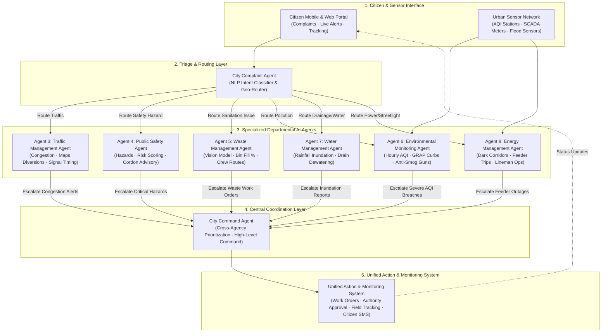

# Smart City Multi-Agent Architecture: Deep Technical Overview

## 1. System Topology

This system implements an intelligent municipal coordination framework where civic complaints and automated IoT sensor streams are triaged, processed by domain-specialized departmental AI agents, and escalated to a centralized City Command Agent for synchronized inter-agency action.

---

## 2. Departmental AI Agents Matrix

| Agent | Purpose | Triggers | Key Tools & APIs | Escalation Condition | Output Contract |
|---|---|---|---|---|---|
| **Agent 3: Traffic Management** | Congestion relief & route optimization | Webhook (`/traffic-agent`) | Google Maps / TomTom Traffic API, Weather API, Directions API | `severity == 'SEVERE'` or active arterial blockage | Congestion report, affected locations, alternative routes, signal timing recommendations |
| **Agent 4: Public Safety** | Hazard analysis & emergency advisory (Non-autonomous) | Webhook (`/public-safety-agent`) | Nearby Incident DB, Sensitive Zone Proximity (schools/hospitals), SMS dispatcher | `risk_level == 'CRITICAL' \|\| 'HIGH'` | Incident report, risk level, cordons, target departments (Police/Fire/DDMA) |
| **Agent 5: Waste Management** | Smart sanitation & visual bin overflow assessment | Webhook (`/waste-agent`) | GPT-4o-Vision / Gemini Flash Vision, Ward DB, Route Optimizer | `overflow > 80%` or chronic dumping hotspot | Waste report, overflow %, vehicle recommendation, collection route |
| **Agent 6: Environmental Monitoring** | Air quality tracking & pollution countermeasures | Schedule (Hourly) + Webhook (`/environment-agent`) | Open-Meteo Air Quality / CPCB AQI API, Wind/Weather API | `AQI >= 301` (Very Poor or Severe) | AQI report, dominant pollutant, anti-smog gun deployment advisory |
| **Agent 7: Water Management** | Drainage, flood mitigation & pipeline leak triage | Webhook (`/water-agent`) | Radar Weather / Precipitation API, 500m complaint clustering DB | `severity == 'CRITICAL'` or underpass inundation > 2ft | Water report, root cause, dewatering pump specs, sluice valve cutoff |
| **Agent 8: Energy Management** | Outage, streetlight failure & public safety intersection | Webhook (`/energy-agent`) | SCADA Feeder Telemetry API, Transformer History DB | Feeder trip, hospital line or dark arterial corridor | Electricity report, breaker status, public safety flag, lineman dispatch |

---

## 3. Operational Guardrails

1. **Advisory Authority (Human-in-the-Loop)**:
   - Departmental AI agents recommend actions, evaluate alternative bypasses, and suggest cordon radii.
   - The agents do **not** independently dispatch armed tactical units or execute destructive physical commands.
   - The **City Command Agent** and **Unified Action & Monitoring System** require departmental authority approval for high-risk interventions.

2. **Cross-Departmental Synergy**:
   - When **Agent 8 (Energy)** detects streetlights dark along a major arterial corridor, it flags `public_safety_impact = true`. This triggers City Command to alert **Agent 4 (Public Safety)** to deploy patrol visibility.
   - When **Agent 7 (Water)** detects critical underpass waterlogging, City Command triggers **Agent 3 (Traffic)** to dynamically push diversion routes on Google Maps and electronic variable message signs (VMS).
