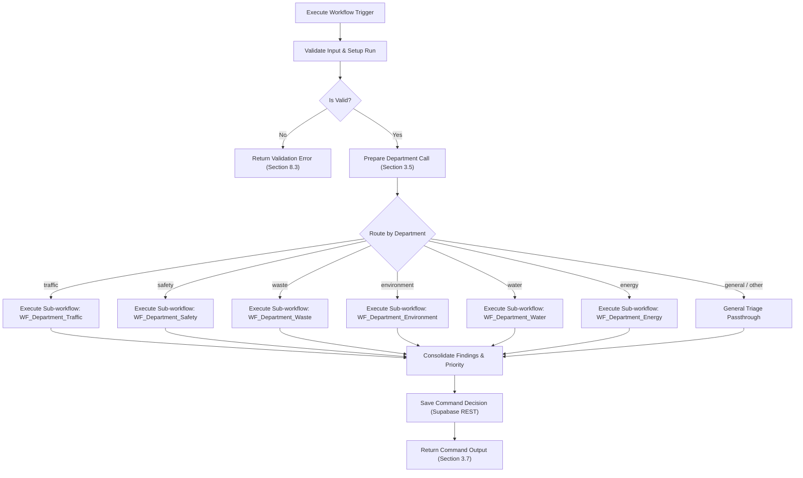

# WF_City_Command — City Command Agent Workflow Documentation

## 1. Overview & Assigned Scope
- **Owner:** Member 1
- **Workflow Name:** `WF_City_Command`
- **Location:** `workflows/WF_City_Command.json`
- **Objective:** Central coordination workflow that receives validated complaints from `WF_City_Complaint`, identifies target department(s), invokes the relevant department workflow(s) via n8n sub-workflow execution, handles department failures gracefully, evaluates overall severity based on strict priority rules, sets `requires_human_approval = true`, saves the decision to Supabase, and returns the canonical Command Agent output.

---

## 2. Shared Contracts Implemented

### 2.1 Trigger & Input
- **Trigger:** n8n `Execute Workflow Trigger`
- **Accepts:** Event payload containing `description`, `source`, `category`/`department`, `location`, `severity`, etc.
- **Validates:**
  - `description`: non-empty string.
  - `source`: one of `['citizen_complaint', 'simulated_sensor', 'admin']`.
  - `severity`: one of `['low', 'medium', 'high', 'critical']` (or defaults/derives).
  - `department`/`category`: one of `['traffic', 'safety', 'waste', 'environment', 'water', 'energy', 'general']`.

### 2.2 Standard Department-Agent Delegation (Section 3.5)
Each invoked department sub-workflow receives:
```json
{
  "event_id": "UUID",
  "complaint_id": "UUID or null",
  "source": "citizen_complaint",
  "department": "waste",
  "description": "Garbage bins are overflowing near the market.",
  "location": {
    "latitude": 28.6139,
    "longitude": 77.2090,
    "location_text": "Demo Market, Sector 1"
  },
  "severity": "medium",
  "context": {}
}
```

### 2.3 Command Agent Output Contract (Section 3.7)
Always returns:
```json
{
  "agent": "city_command",
  "event_id": "UUID",
  "complaint_id": "UUID or null",
  "overall_severity": "low | medium | high | critical",
  "priority_reason": "string",
  "departments_involved": ["department_name"],
  "agent_results": [ ... ],
  "consolidated_recommendations": [ ... ],
  "requires_human_approval": true,
  "status": "awaiting_human_review",
  "created_at": "ISO-8601 UTC timestamp"
}
```

---

## 3. Workflow Architecture in n8n



---

## 4. Priority Rules (Section 4.3)
1. **`critical`**: Supplied information explicitly indicates an immediate threat to life or serious danger. (No inference from mere dramatic wording).
2. **`high`**: Significant public safety or infrastructure disruption indicated; timely intervention recommended.
3. **`medium`**: Service disruption or civic issue requiring timely attention.
4. **`low`**: Minor civic issue with no stated immediate risk.
5. **Insufficient Information**: Severity defaults to `medium`, with explicit statement that human verification is needed.

---

## 5. Failure Handling (Section 4.5 Acceptance Criteria)
- Department sub-workflow failures or timeouts are caught (`continueRegularOutput`).
- The error is captured in `agent_results` with status `failed`.
- The consolidated recommendation states: `"Department assessment for [dept] was unavailable or returned an error; require manual inspection by [dept] supervisor."`
- **Zero Hallucination:** A successful result is never fabricated when a department fails.

---

## 6. Remaining Configuration Steps for Human Team
1. **Import Workflow into n8n:**
   - In n8n UI, click **Workflows** -> **Import from File**, select `workflows/WF_City_Command.json`.
2. **Environment Variables:**
   Configure the following environment variables in `.env` or in the n8n container:
   - `SUPABASE_URL`: e.g. `https://your-project.supabase.co`
   - `SUPABASE_SERVICE_ROLE_KEY`: Service role API key for writing to `command_decisions`.
   - `GEMINI_API_KEY`: Used if LLM summarization enrichment is activated.
3. **Department Sub-Workflows:**
   Ensure Member 3's six department sub-workflows are created and named canonically:
   - `WF_Department_Traffic`
   - `WF_Department_Safety`
   - `WF_Department_Waste`
   - `WF_Department_Environment`
   - `WF_Department_Water`
   - `WF_Department_Energy`
